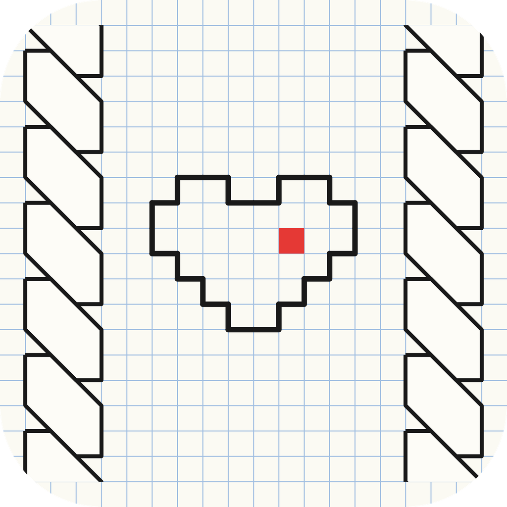

  

<h1 align="center">Tetrad</h1>

  Рисование по клеточкам, как в школьной тетради, в одном HTML-файле. 
  Grid drawing like in a school notebook, in a single HTML file.

  <a href="https://github.com/Finn013/Tetrad/releases/latest">Скачать / Download</a> ·
  <a href="https://finn013.github.io/Tetrad/">Открыть онлайн / Open online</a>

---

## 🇷🇺 О приложении

> **Для тех, кто в детстве изрисовывал последние страницы тетрадей.** Косички на полях, пиксельные сердечки, узоры, которые «вели» по клеточкам на скучном уроке, — если это про вас, Tetrad вернёт то самое чувство. Только теперь ручка не кончается, ластик не рвёт бумагу, а тетрадь всегда с собой.

Tetrad — рисовалка по клеточкам. Линии сами прилипают к узлам сетки, так что рисунок всегда получается ровным. Работает без интернета и без регистрации, все рисунки хранятся на вашем устройстве.

### Возможности
- **Два режима:** «Тетрадь» со страницами и «Бесконечное поле» без границ.
- **Три тетради:** в клетку, в треугольники и в шестиугольники. У каждой свои страницы.
- **Страницы** с красными полями и номером: листайте вперёд и назад, добавляйте и удаляйте. Перелистывание с анимацией гибкого листа.
- **Линии** по узлам сетки: цвет, толщина, сплошные и пунктирные.
- **Удаление** целой линии или только отрезка между пересечениями.
- **Заливка** по контуру или одним касанием внутрь замкнутой области, выбор цвета, удаление заливки.
- Отмена и повтор действий, масштаб и перемещение (колесо мыши или два пальца).
- **Автосохранение** после каждого изменения.
- Сохранение страницы или поля в **PNG**, экспорт и импорт всех тетрадей в `.json`, отдельные проекты.

## Скачать

| Платформа | Файл | Статус |
|---|---|---|
| Любое устройство с браузером | `Tetrad.html` | ✅ Доступно |
| Android 7+ | `Tetrad.apk` | ✅ Доступно |
| Windows 10/11 | `Tetrad-Setup.exe`, `Tetrad-Portable.exe` | ✅ Доступно |
| iPhone, iPad, Mac | [finn013.github.io/Tetrad](https://finn013.github.io/Tetrad/) | ✅ Доступно |

Все файлы — в [релизах](https://github.com/Finn013/Tetrad/releases/latest).

**iPhone/iPad:** откройте ссылку в Safari → «Поделиться» → «На экран Домой».
**Mac:** Safari → «Файл» → «Добавить в Dock» (в Chrome/Edge — значок установки в адресной строке).
После первого открытия приложение работает без интернета.

> Сборки Windows не подписаны: если SmartScreen предупредит, нажмите «Подробнее» → «Выполнить в любом случае».

> Рисунки хранятся на этом устройстве. Для резервной копии используйте «Файл» → «Экспорт JSON».

## Идеи и ошибки
Пишите в [Issues](https://github.com/Finn013/Tetrad/issues).

---

## 🇬🇧 About

> **For everyone who covered the back pages of their school notebooks with doodles.** Braids in the margins, pixel hearts, patterns traced cell by cell during a boring lesson — Tetrad brings that feeling back. Only now the pen never runs dry, the eraser never tears the paper, and the notebook is always with you.

Tetrad is a grid drawing app inspired by school notebook doodles. Lines snap to grid nodes, so every drawing comes out neat. No internet, no sign-up: everything stays on your device.

### Features
- **Two modes:** a paged **Notebook** and an **Infinite field**.
- **Three notebooks:** square, triangle and hexagon grids, each with its own pages.
- **Pages** with a red margin and page numbers; add, delete and flip through them with a bending-page animation.
- **Lines** snapped to the grid: color, thickness, solid or dashed.
- Delete a whole line or just one segment between intersections.
- **Fill** by outlining a shape or with one tap inside a closed area; pick a color, remove fills.
- Undo/redo, zoom and pan (mouse wheel or two fingers).
- **Autosave** after every change.
- Save a page or the field as **PNG**; export/import all notebooks as `.json`; named projects.

## Download
- **Any browser:** `Tetrad.html`
- **Android 7+:** `Tetrad.apk`
- **Windows 10/11:** `Tetrad-Setup.exe` or `Tetrad-Portable.exe`
- **iPhone, iPad, Mac:** open [finn013.github.io/Tetrad](https://finn013.github.io/Tetrad/) in Safari and add it to the Home Screen / Dock.

All files are in [Releases](https://github.com/Finn013/Tetrad/releases/latest). Windows builds are unsigned; if SmartScreen warns, click “More info” → “Run anyway”.

> The interface is in Russian. Drawings live on your device — use File → Export JSON for backups.
